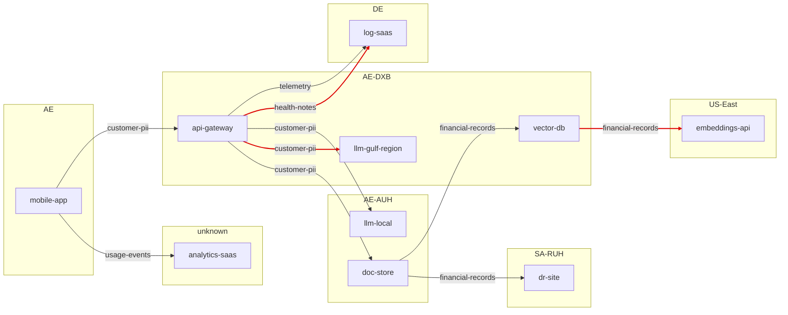

# sovereign.map

A bank in Dubai adds an assistant. Somewhere in the pipeline, a text embedding call goes to a server in Virginia. Nobody decided that. A default did. Months later a regulator asks where customer data is processed, and the honest answer is a search through code and invoices.

sovereign.map asks the question before the regulator does. It models your architecture as nodes in jurisdictions and flows of named data classes, checks it against the residency, control and transfer rules you write, and tells you what to fix. It was built for regulated deployments in the Gulf and Southeast Asia, but the jurisdiction labels and the rules are yours, so it fits any regime. Standard library only, Python 3.10 to 3.13, typed.

**Not legal advice.** It enforces the rules you give it. It does not know what the law requires, and the example policy in this repository is an illustration, not a reading of any statute.

## The problem it answers

A reviewer asks three questions: where does personal data get processed, who controls the systems that touch it, and what leaves the country. A diagram cannot answer them reliably and a spreadsheet goes stale. sovereign.map turns the diagram into data you can check in CI, so a pull request that sends customer records to an embeddings API hosted in the United States fails the build and names the fix.

## Use

```python
from sovereign_map import Architecture, Flow, Node, Policy, diff, evaluate

arch = Architecture.of(
    [Node("app", "AE-DXB", operator="AE"), Node("vectordb", "AE-AUH", operator="AE"),
     Node("llm-api", "US-East", operator="US", kind="model"), Node("llm-local", "AE-DXB", operator="AE", kind="model")],
    [Flow("app", "vectordb", "personal"), Flow("app", "llm-api", "personal")],
)
policy = Policy(processing={"personal": frozenset({"AE", "EU"})}, control={"personal": frozenset({"AE"})}, home="AE")

report = evaluate(arch, policy)
report.ok                      # False
for f in report.findings:
    print(f.rule, f.reason, "|", f.hint)
# control   personal is handled by llm-api, operated under US law | operator must be under: AE
# processing personal may not be processed in US-East (llm-api)    | permitted: AE, EU; compliant model already in this architecture: llm-local
report.fingerprint             # sha256 of the exact architecture and policy that were checked
```

The 0.1 calls still work unchanged: `check(nodes, flows, {"personal": {"AE"}})`, `exposure(nodes, flows)`, `egress(nodes, flows, "AE")`.

## What it checks

| Rule | Fires when |
|---|---|
| `processing` | data of a class is stored or processed in a jurisdiction the policy does not allow. Both ends of every flow are checked. |
| `deny` | data touches a jurisdiction the policy forbids outright |
| `control` | a node that handles the data is operated under a jurisdiction the policy does not allow, even if its region is local (a cloud region in your own country that a foreign company owns) |
| `transfer` | a flow across a border does not name an accepted mechanism, unless both ends sit in a group you declared free (for example GCC) |
| `protection` | a flow across a border lacks a protection you require (`tls`, `customer-key`, `tokenized`) |
| `unknown-node` | a flow names a node you did not declare. It is reported, never skipped. |
| `control-undeclared` | a control rule applies and the node does not say who operates it. A warning, because guessing would hide the gap. |

With `--lint` it also warns about nodes with no flows, nodes with no known location, data classes with no rule that you have not declared open, and rules for classes nothing carries (usually a typo that leaves data unprotected).

## Design

- **Both ends, every ancestor.** A flow is compliant only if source and destination both satisfy every rule for the class and for each parent class (`health` inherits the rules of `personal`).
- **Control is not location.** A node has a jurisdiction (where it runs) and an operator (whose law controls the party running it). Leave the operator out and control rules say so instead of assuming.
- **Unknown stays unknown.** A node whose location is `unknown`, `?` or empty is covered by nothing, not even `*`, so restricted data sent there is always a finding.
- **Labels are hierarchical.** `US` covers `US-East`, and `AE-DXB` to `AE-AUH` is not a border crossing. Groups (EU, EEA, GCC, ASEAN included, your own on top) can nest. Turn the hierarchy off with `"hierarchical": false` for labels that use dashes as part of a name.
- **Strict input.** An unknown key in an architecture or policy file is an error naming the place, because a misspelt `jurisdication` would otherwise silently disable a rule.
- **Deterministic.** Findings come out in a total order and the report carries a SHA-256 fingerprint of the canonical architecture and policy. The same inputs give the same output on any machine and any hash seed, whatever order they were written in. Tests run the CLI under different hash seeds and compare byte for byte.
- **Unrestricted by default, but loudly.** A data class with no rule is allowed everywhere. `--lint` makes you say so on purpose.

## Command line

```
sovereign-map check ARCH POLICY [--format text|json|markdown|sarif] [--fail-on error|warning|never] [--lint]
sovereign-map diff BEFORE AFTER POLICY [--fail-on-new]
sovereign-map graph ARCH [POLICY] --format dot|mermaid
sovereign-map exposure ARCH      sovereign-map egress ARCH --home AE
sovereign-map paths ARCH CLASS SRC DST      sovereign-map fingerprint ARCH POLICY
```

Exit codes: 0 pass, 1 the gate was hit, 2 bad input. `check --format sarif` feeds code scanning tools. `diff --fail-on-new` is the pull request gate: it compares an architecture before and after a change under one policy and fails only if the change adds an error, so an existing backlog does not block unrelated work. `sh examples/demo.sh` runs everything once.

## Reference architecture

`examples/gulf_rag` models a retail bank assistant (mobile app, gateway, document store, vector database, three model endpoints, observability, disaster recovery) against an illustrative policy. Nine errors, pinned in the tests, and several flows that pass for the reason the policy intends (GCC free transfer, a local model, open telemetry). The red flows below are the ones with an error. The Mermaid and DOT output were both rendered with the Mermaid command line tool and Graphviz at this commit.



## Measured

`python examples/evaluate.py` prints these. The cases are seeded random architectures and policies, so every figure reproduces.

```
oracle agreement        3000/3000 random cases, 59965 findings across them
findings by rule        control 9493, control-undeclared 3205, deny 3104, processing 31512, protection 3657, transfer 4353, unknown-node 4641
mutation detection      948/948 out-of-bounds moves caught on every flow touching the moved node
order independence      1000/1000 shuffles gave identical findings and fingerprint
scale                   20000 flows over 2000 nodes: 43205 findings in 0.68s; diff of two such architectures in 1.47s (this machine)
```

Agreement is with a second implementation in `tests/test_properties.py`, written separately straight from the definitions. It shows the engine does what the definitions say. It does not show that the definitions match any law, which is why the rules are yours. The property tests also check that narrowing an allowed set or adding a deny never removes an error, that saving and reloading an architecture preserves the verdict, and that a diff against itself is empty and is symmetric. Timings depend on the machine.

## Honest limits

- **It checks a model, not a system.** If the architecture file leaves out a flow, a backup, a log line or a support engineer with remote access, the tool cannot see it. `--lint` catches orphans and typos, not omissions.
- **Flows are data classes you name.** Whether a payload really is "personal" or has been anonymised is your call. Model an anonymised stream as its own class.
- **Mechanism and protection are labels you assert.** The tool matches the words on a flow against the words in the policy. It cannot verify that a contract exists or that a key is held by the customer.
- **The groups that ship with the tool are geography.** EU, EEA, GCC and ASEAN are membership lists for convenience, as of this release. Override any of them in a policy if your reading differs.
- **Hierarchy is a naming convention.** The part of a label before the first `-`, `/` or `:` is the jurisdiction. A label such as `on-prem` is read as region `prem` of jurisdiction `on` unless you set `hierarchical` to false.
- **Time is not modelled.** Retention periods, data at rest versus in motion, and staged migrations are outside the model.
- **Not legal advice.** It enforces the rules you give it.

## Tests

```
python -m unittest discover -s tests -t . -v
```

86 tests, run on Python 3.10 to 3.13 in CI with ruff and mypy in strict mode. CI also runs the reference architecture through the CLI.

MIT licensed. Built by [AndMaverick LLC](https://www.andmaverick.com).

---

**Read the thinking:** [Your AI Has a Passport Problem](https://blog.andmaverick.com/your-ai-has-a-passport-problem?utm_source=github&utm_medium=repo&utm_campaign=sovereign.map)

**If this is your problem.** If your data, language, or jurisdiction sits outside the assumptions of American AI infrastructure, that is work I do. Let us talk. [Begin a conversation](https://calendly.com/andmaverick?utm_source=github&utm_medium=repo&utm_campaign=sovereign.map).
